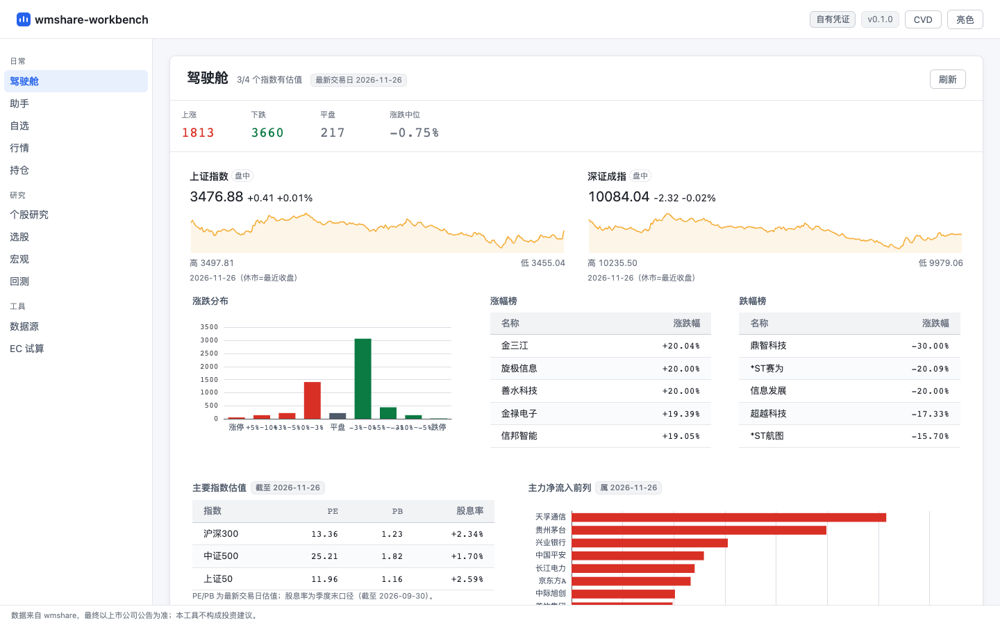
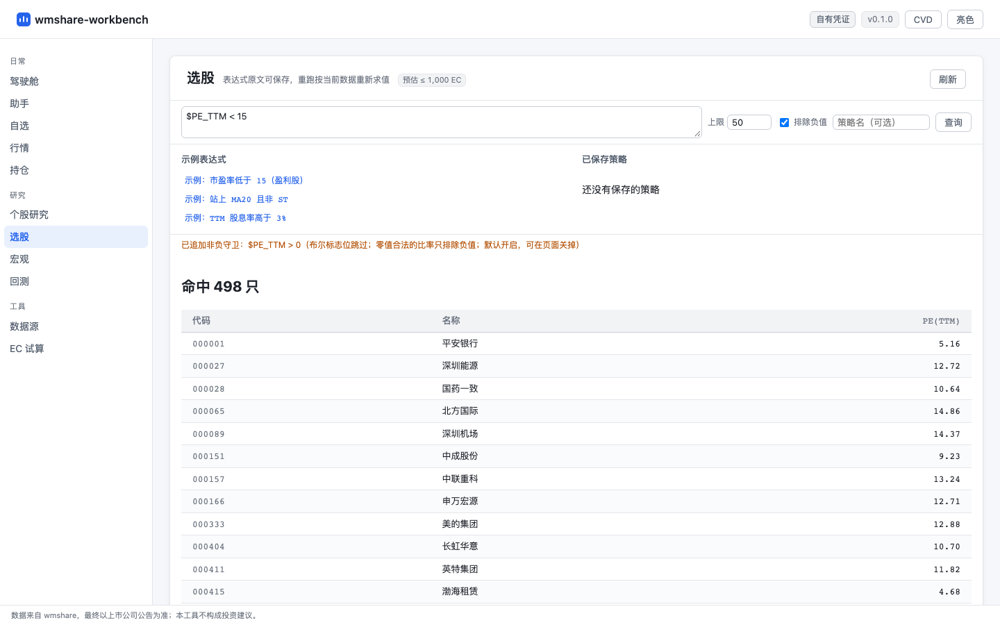
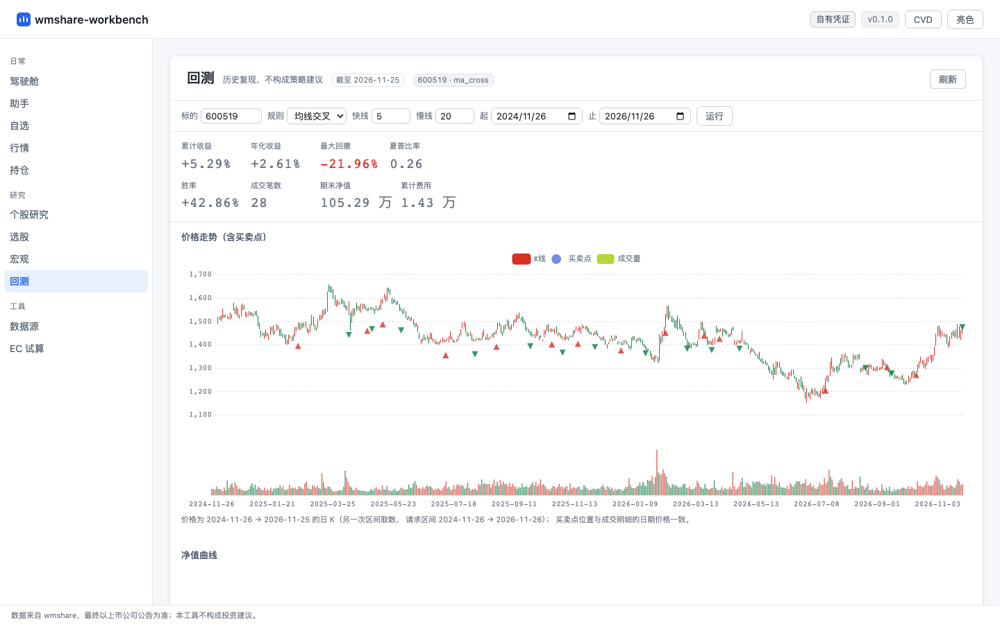
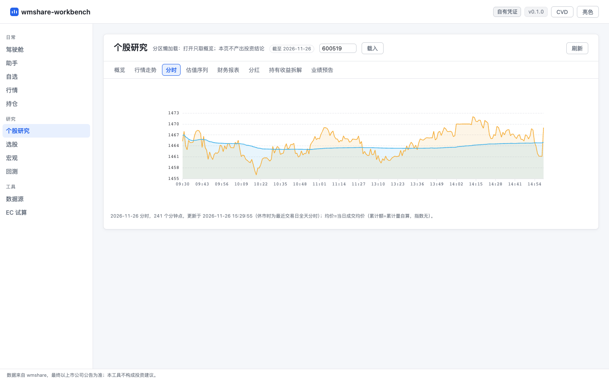
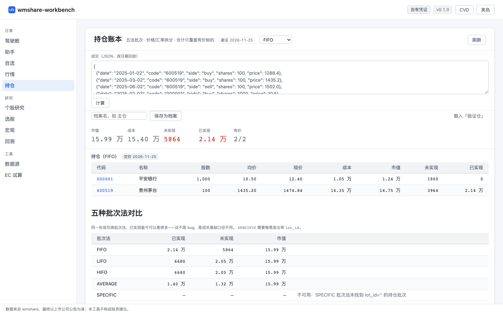
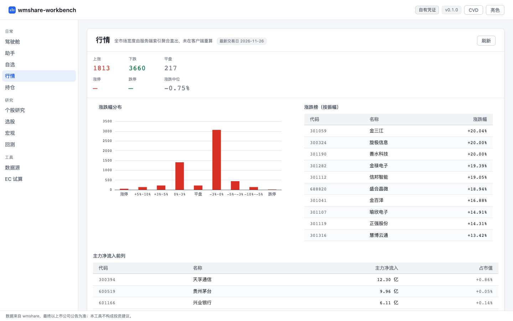

# wmshare-workbench

**本地 A 股投研工作台**——以 [wmshare](https://github.com/open-winmale/wmshare) 为数据层，
一条命令装好，起单端口服务，浏览器打开即用。

盘中实时盘面 · 表达式选股 · 历史回测 · 分区懒加载的个股研究 · 五法成本账本 · AI 数据问答

[](pyproject.toml)
[](pyproject.toml)
[](SECURITY.md)
[](tests/)
[](LICENSE)

> 不给买卖结论、不给目标价、不对接券商。每个数字都带 `as_of` 与新鲜度判决，
> 缺失显示 `—` 而不是 `0`。

## 截图

驾驶舱：三大指数盘中卡（现价 / 高低 / 分时缩略）、涨跌分布、涨跌幅双榜、
主力净流入、指数估值——每块标自己的数据日期。



## 特色功能

### 实时工作台

不自动轮询，你要就点「刷新」——省额度也省得你在收盘后盯着一屏不动的数字。

- **今日盘面**：上证 / 深证成指 / 创业板指现价卡（分时缩略 + 高低 + 数据日期）、
  涨跌分布直方图、涨跌幅双榜、主力净流入前列。
- **两道兜底守卫**：上游对断供键会返回「别的指数的整行」或「上一交易日的行」。
  前者用同值判据剔除，后者用 max-date 剔除——不把假数字画成真行情，宁可少一张卡。
- **快慢数据分开标注**：盘中价与实时宽度标最新交易日；PE/PB 标估值日；
  股息率标季度末——不与实时混排。
- **自选实时开关**：现价/涨跌幅切到盘中快照，休市则如实标注「最近收盘」。
- **个股分时**：当日 1 分钟 + 均价线（自算 VWAP，指数无均价）。

### 选股

表达式选股，`&&` / `||` / `!`，写 `and` 会被本地拦下并提示改写——
一次查询给出命中数，表格只渲染你要的列：



- **策略可存可重跑**：存的是表达式原文，重跑按当前数据重新求值（不是冻结结果）。
- **非负守卫默认开**：按表达式引用的指标自动追加 `$X > 0`，亏损股的负 PE 不再
  把「低估值」变成「亏得最狠」。追加了什么在页面明写，可关。
  布尔标志位跳过；零值合法的比率（商誉 / 有息负债率）只排除负值。
- **成本前置**：预估超 40,000 EC 先返回确认请求，**确认前零网络请求**。

### 回测

均线交叉或估值阈值，买卖点直接标在价格 K 线上——不是标在净值上：



- **强制区间**：不给区间会取全历史（数十万 EC），后端直接拒绝并告诉你先试近一年。
- **八个汇总数字**：累计收益、年化、最大回撤、夏普、胜率、成交笔数、期末净值、
  累计费用。上游不返回的两个（期末净值、累计费用）由净值末点与成交费用现算，
  不是猜的。
- **口径可见**：执行价（次日开盘）、T+1、手数、费率、印花税、滑点跳过数全在
  `caliber` 里摊开。
- **定位是历史复现**：不给推荐参数、不给预期收益。

### 个股研究

八个分区懒加载，打开只取概览——不点就不花钱：

概览 · 行情走势 · 分时 · 估值序列 · 财务报表 · 分红 · 持有收益拆解 · 业绩预告



财务报表支持年报/季报切换与利润表/资产负债表/现金流量表三表；收益拆解按持有
年限把总收益拆成价格贡献与股息贡献。

### 持仓账本

同一份成交、五种成本法（FIFO / LIFO / HIFO / 加权平均 / 指定批次）**并排算给你看**——
同一批交易的已实现盈亏能差好几倍，这不是 bug，是成本基础口径不同：



> 截图为功能演示：成交清单是手填的示例输入（页面可编辑/可存档），
> 价格与市值是当日真实行情。

价格盈亏与汇率盈亏分开列且可对账；合计只覆盖有价标的（`2/2` 那种计数），
缺价的单独标出来而不是按 0 算。

### 行情与宽度

全市场涨跌宽度、分布直方图、涨跌榜、主力净流入——全部由服务端索引聚合直出，
不在客户端重算：



### AI 数据问答（可选）

单 agent、工具按数据域分组（行情 / 基本面 / 筛选 / 宏观 / 组合）。**每个数字带来源
编号**，回答里是 `[1]` 这样可点的来源芯片；贵接口有单轮 EC 预算闸，超预算如实说明。
自备一个 OpenAI 兼容模型的 Key 即可，不配不影响其他工具。

## 快速开始

### 方式一：装预构建包（推荐，不需要 Node）

```bash
pip install https://github.com/open-winmale/wmshare-workbench/releases/latest/download/wmshare_workbench-py3-none-any.whl
wmshare-workbench
```

打开 <http://127.0.0.1:8787/> 即可。这个 wheel **自带界面**，不克隆仓库、
不装 Node、不需要构建。数据来自 wmshare：装了 SDK 即为免注册真实数据。

### 方式二：从源码运行（改代码/参与开发时用）

```bash
git clone https://github.com/open-winmale/wmshare-workbench && cd wmshare-workbench
python -m pip install -e ".[data]"
python -m workbench.build        # 构建前端产物（需要 Node ≥ 18.18）
python run.py                    # → http://127.0.0.1:8787/
```

前端产物**不入库**（构建输出不进 git），所以从源码安装必须构建一次——
这是唯一需要 Node 的场景。Windows 上没有 GNU make 也能用上面的 `python -m`
命令；习惯 make 的话 `make web` 等价。

> 如果打开页面看到「前端尚未构建」，就是少了上面那步构建：源码安装跑
> `python -m workbench.build`；否则换用方式一的自带界面 wheel。

### 三种访问方式（页顶始终标明当前是哪种）

| 方式 | 条件 | 数据 |
|---|---|---|
| 自有凭证 | `wmshare setup` 或环境变量 | 真实，独立额度 |
| **免注册** | 装了 wmshare，不配任何凭证 | 真实（服务端按来源网络记账） |
| 未接入 | 未装 wmshare，或免注册被禁且无凭证 | 无——给接入指引，**不返回任何假数据** |

**运行时没有任何内置假数据**：未接入时每个工具都渲染接入指引，而不是一屏看着像
真的数字。免注册的实测边界：`screener.query` 与 `kline.query_last_live_many` 被
服务端策略拒绝（自选页自动逐票降级并告知请求次数，选股页如实提示需配凭证）。

### AI 助手额外配置（可选）

在 `~/.wmshare/credentials.env` 或环境变量里加 `WMSHARE_LLM_API_KEY`；
`WMSHARE_LLM_BASEURL` / `WMSHARE_LLM_MODEL` 不填默认 DeepSeek。
单轮取数预算默认 5,000 EC，用 `WMSHARE_LLM_MAX_EC` 调整。

## 为什么可信

三条产品原则，每条都有对应机制（不是文案）：

| 原则 | 机制 |
|---|---|
| **口径优先** | 每个信封带 `as_of` + `freshness`；推断出来的日期标「最新交易日」而不是「截至」；快慢数据分开标注 |
| **不骗人** | 缺失用 `NaN` 哨兵、页面渲染 `—`；无成本模型时 `ec` 写 `null` 不是 `0`；量价不变量与同值兜底行都有守卫 |
| **成本可见** | 花钱的操作事前给 EC 区间；超阈值要二次确认，取消则零请求；一句话说清「这次为什么贵」 |

数据来自 wmshare：30 个数据域 / 370 余个目录函数 / 近 3,000 个服务端预计算指标。
**先在目录里查有没有算好的，再决定要不要自己算**——这是仓库的第一条开发纪律。

## 架构

```
backend/workbench/     Python 包（零第三方运行期依赖，只用标准库）
  core/                信封契约（唯一真源）+ 端点表
  platform/            stdlib ThreadingHTTPServer、SQLite、凭证
  client/              取数适配、缓存、成本台账、账本计算
  tools/               每页一个 handler，统一信封出
  static/              前端构建产物（随包发布）
frontend/              Vue 3 + Vite + ECharts，构建直出到上面的 static/
gates/                 八个质量门禁 + 契约生成 + 真实模式冒烟
tests/                 离线用例（全部用 FakeFetcher，不烧真实配额）
quality/baselines/     七份棘轮基线
```

几个刻意的选择：

- **单端口**：API 与静态产物同一个 `ThreadingHTTPServer`，只绑 `127.0.0.1`，
  拒绝其他 host。没有反向代理、没有 CORS、没有第二个进程。
- **hash 路由**：`#/dashboard` 这种，刷新任意页面都直接命中 `index.html`，
  后端不需要 SPA fallback。
- **契约生成**：`core/envelope.ENDPOINTS` → `gates/gen_contract.py` →
  `frontend/src/api/contract.ts`，前后端端点表只有一份真源。
- **前端产物进 wheel**：`package-data` 里带 `static/**/*`，`check_wheel` 断言它
  真的在包里——否则 `pip install` 拿到的包没有界面。

详见 [docs/ARCHITECTURE.md](docs/ARCHITECTURE.md)。

## 质量门禁

八个门禁全部离线、零网络、零凭证：

```bash
make check     # 八个门禁
make test      # 453 个离线用例
make preview   # 上面两个一起跑（提交前用这个）
```

| 门禁 | 拦住什么 |
|---|---|
| `check_layers.py` | 反向依赖、跨层耦合、未登记的层间边 |
| `check_sizes.py` | 文件/函数体量与圈复杂度**变大**（棘轮只许变小） |
| `check_tokens.py` | 组件内裸色值/非标像素、令牌缺失 |
| `check_envelope.py` | 信封野字段、`ok=False` 却带非空 `data`、无成本模型写 `0`、吞异常 |
| `check_contract.py` | 契约漂移、版本三元不一致 |
| `check_docs_links.py` | Markdown 相对链接与图片指向不存在的文件 |
| `check_plan.py` | 台账缺证据、统计行被手改、README 用例数与实际不符、债务缺触发条件 |
| `gen_component_index.py` | 孤儿组件（0 引用） |

**门禁本身也被测试**：`tests/test_gates_selftest.py` 逐个注入违规，断言它们真的会红——
一个永远返回 0 的门禁比没有门禁更危险。

## 文档

| 文档 | 内容 |
|---|---|
| [ARCHITECTURE](docs/ARCHITECTURE.md) | 双栈布局、契约生成、构建交付、单端口规则 |
| [PROJECT_SPEC](docs/PROJECT_SPEC.md) | 分层与依赖方向、体量棘轮、禁止清单、腐化信号 |
| [DESIGN_SYSTEM](docs/DESIGN_SYSTEM.md) | 令牌全表、数字呈现、表格与图表规则、五态规范 |
| [TRACKING](docs/TRACKING.md) | 跟踪结构、状态机、DoD、可机械验证的验收条件 |
| [PLAN](docs/PLAN.md) | 阶段计划与验收标准 |
| [PROGRESS](docs/PROGRESS.md) | 任务台账（工作项 / 验收条件 / 证据） |
| [DEBT](docs/DEBT.md) | 技术债与已知缺陷（每条带触发条件） |
| [ENVELOPE](docs/ENVELOPE.md) | 信封契约（版本化，只许追加） |
| [EC_BUDGET](docs/EC_BUDGET.md) | 取数成本登记与预算纪律 |
| [ADR](docs/ADR/) | 不可逆决策记录 |

## 参与

- 贡献流程与验收条件写法见 [CONTRIBUTING.md](CONTRIBUTING.md)。
- 安全模型（本机单用户、无鉴权、**不要暴露到局域网**）见 [SECURITY.md](SECURITY.md)。
- 用 AI 代理改这个仓库的，读 [AGENTS.md](AGENTS.md)。

## 设计说明

亮/暗双主题（默认 Business Light）+ 12 色序列调色板（经色觉障碍相邻对校验）+
中文无衬线正文与等宽数字。12 色图表调色板与等宽字体族的**数值**参考了
[FinceptTerminal](https://github.com/Fincept-Corporation/FinceptTerminal)（AGPL-3.0），
**仅取数值，未复制任何代码、图标或文案**；语义色、字体栈、阴影、间距、圆角、
断点均由本项目自定。依据与许可边界见 [ADR-001](docs/ADR/001-adopt-peer-design-tokens.md)
与 [ADR-002](docs/ADR/002-self-defined-business-theme.md)。

## 许可与免责

代码 MIT（见 [LICENSE](LICENSE)）。数据依赖 wmshare（BSD-3-Clause），云端数据服务
的使用条款以开放平台为准。

本工具做数据整理、统计聚合与历史归因，**不构成任何投资建议**。
数据最终以上市公司公告为准。
